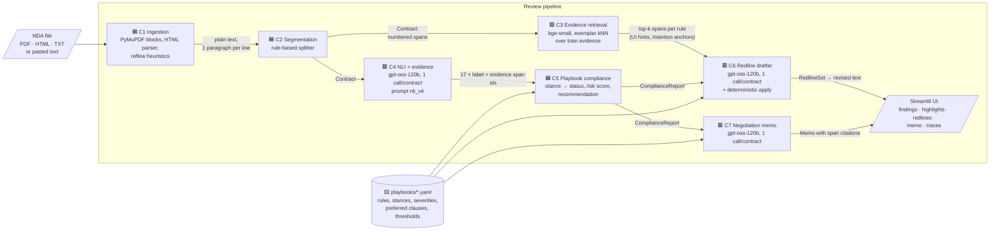
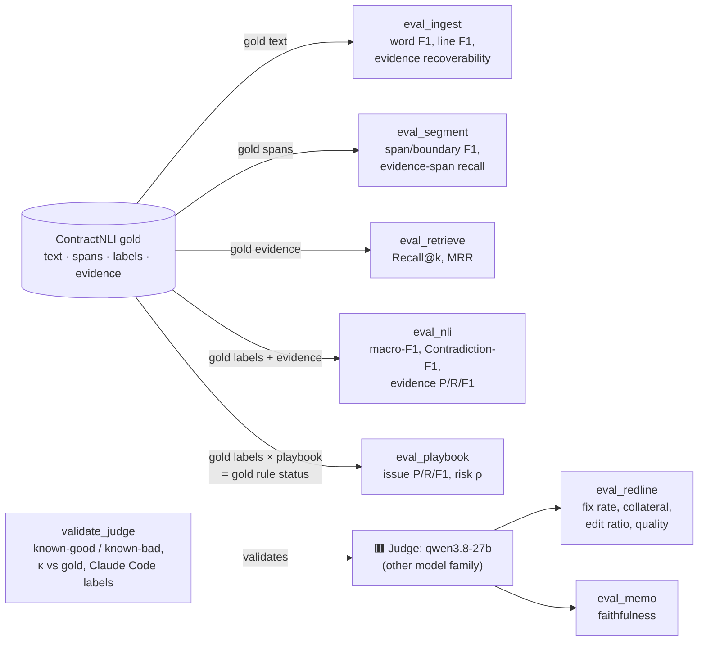

# Data flow

Legend: 🟦 tool / deterministic code · 🟩 local model (CPU/GPU) · 🟥 LLM call (Groq) · 🟨 configuration

## Evaluation flow (what each eval compares against)

LLM calls per contract: 3 system calls (C4, C6, C7). The evals add judge calls (C6: 2 NLI + 1 quality call;
C7: 1 faithfulness call).
