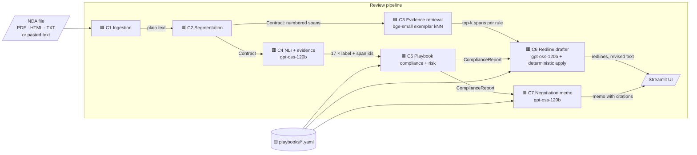

# NDA Playbook Reviewer: Report
UCU GenAI, Assignment 1 "Build an NLP System". Built with Claude Code as the coding agent.

The details behind every section are in the CRISP-DM documents `docs/crisp-dm/01…06`. Every number links to
a result file in `evals/results/`. This report is the summary.

## 1. The task
**Lumen Robotics** (fictional) is a 40-person hardware start-up that signs about 10 NDAs a month. Today each
NDA goes to an external lawyer: €150–250 and 2–5 days per review. Most NDAs are routine.

The system does a **first-pass review against the company's own playbook**. A playbook is a set of
negotiating positions, such as "the counterparty must not reverse-engineer our prototypes", each with a
severity, a preferred clause and a fallback. For each of 17 positions the system:
1. decides whether the contract **entails** it, **contradicts** it or **doesn't mention** it, citing the exact
   clauses;
2. turns the labels into a rule status (OK / VIOLATION / MISSING / REVIEW) and a risk score with a
   sign / negotiate / reject recommendation;
3. drafts **redlines** that fix the issues;
4. writes a **negotiation memo** for the lawyer.

The business logic is configuration (`playbooks/*.yaml`). The company sits on both sides of NDAs, so there are
two playbooks, `disclosing_party` and `receiving_party`. The same contract can be fine from one side and risky
from the other.

**Data:** ContractNLI (Koreeda & Manning 2021, CC BY 4.0). It has 607 real NDAs, 17 fixed hypotheses, a gold
label for every (contract, hypothesis) pair, gold evidence spans, and the original PDF/HTML/TXT files.
Splits: 422 train / 61 dev / 123 test. One train document is excluded because it duplicates a test document.

**Success criteria** (phase 1, set before any modelling):

| Objective | Metric | Target |
|---|---|---|
| don't miss problems | issue recall | ≥ 0.85 |
| don't waste the lawyer's time | issue precision | ≥ 0.70 |
| every finding is checkable | evidence F1 | ≥ 0.60 |
| fixes fix | redline fix rate (independent judge) | ≥ 0.80 |
| fixes don't break other things | collateral changes | ≤ 5 % |
| the memo is trustworthy | coverage / citation validity | 100 % / ≥ 0.95 |
| cheaper and faster than a lawyer | cost, time per contract | < $0.02, < 2 min |

## 2. System
Legend: 🟦 tool / deterministic code · 🟩 local model · 🟥 LLM call (Groq) · 🟨 configuration

(The full diagram, plus the evaluation-flow diagram, is in `docs/diagrams/data_flow.md`.)

| # | Component | Purpose | Input → output (pydantic, `schemas.py`) | Type |
|---|---|---|---|---|
| C1 | `ingest.py` | read any NDA file | PDF/HTML/TXT bytes → `IngestResult` (text, one paragraph per line, warnings) | **tool**: PyMuPDF, HTML parser, reflow heuristics |
| C2 | `segment.py` | make clauses addressable | text → `Contract` (numbered spans with char offsets) | **tool**: rule-based splitter |
| C3 | `retrieve.py` | find where each topic is regulated | `Contract` × hypotheses → ranked span ids per hypothesis | **local model**: bge-small, kNN against train evidence |
| C4 | `nli.py` | what the contract says on each topic, with evidence | `Contract` × 17 hypotheses → `NLIResult` (label, evidence span ids, rationale) | **LLM**: gpt-oss-120b, 1 call per contract |
| C5 | `playbook.py` | apply company policy | `NLIResult` × playbook → `ComplianceReport` (status, severity, risk, recommendation) | **tool**: deterministic rules from YAML |
| C6 | `redline.py` | fix the contract | issues × `Contract` × playbook → `RedlineSet` → revised text | **LLM**: gpt-oss-120b (drafting) + **tool** (applying edits by span id) |
| C7 | `memo.py` | explain to the lawyer | report × `Contract` × playbook → `Memo` (items with ask, fallback, citations) | **LLM**: gpt-oss-120b; recommendation comes from C5, not the LLM |

Design decisions (details in `04-modeling.md`):
- **One C4 call per contract, not per rule.** Contracts fit in context, so the model sees cross-references.
  It is 17× cheaper.
- **Evidence and citations are span ids, never quotes.** Hallucinated quotes are impossible. Ids are validated
  in code.
- **The LLM explains, the policy decides.** The recommendation is computed in C5 from playbook thresholds.
- **A judge from a different model family** (`qwen/qwen3.8-27b`) grades C6 and C7, and it is validated first.
- All LLM calls go through one gateway (`llm.py`) with a disk cache, JSONL traces (tokens, cost, latency),
  retries that honour `retry-after`, and pydantic validation with one repair retry. Prompts are versioned
  files whose hash is stored in every result.

## 3. Process: CRISP-DM
Each phase has a document in `docs/crisp-dm/`. The agent may not start a phase before the previous document
exists (CLAUDE.md and the `crisp-dm-checkpoint` skill).

| Phase | Document | Key content |
|---|---|---|
| 1 Business understanding | `01-business-understanding.md` | users, objectives → numeric targets, scope, risks, plan |
| 2 Data understanding | `02-data-understanding.md` | 5 datasets compared, label distribution per hypothesis, lengths, the duplicate, imbalance |
| 3 Data preparation | `03-data-preparation.md` | split policy, derived gold (rule status), exemplar index, fine-tuning pairs, segmentation and annotation conventions **measured on train** |
| 4 Modeling | `04-modeling.md` | approach, baselines and alternatives per component, parameters |
| 5 Evaluation | `05-evaluation.md` | metric + justification per component, dev numbers, failure analysis, iteration log, final test |
| 6 Deployment | `06-deployment.md` | Streamlit app, latency and cost, monitoring, risks |

**The loop was used, not just documented.** The iteration log in `05-evaluation.md` has 17 rows. Each one
records a change, the metric delta and a decision, and several of them went *back* to an earlier phase:
- C4 error analysis showed that most errors were about *how to read* a hypothesis. That sent us back to data
  preparation, where the annotation conventions were measured on train (phase 3), and then to a new prompt.
- Prompt v2 took one convention from a single dev example. It turned out to be wrong on train (150 vs 69) and
  was reverted. This became a rule in CLAUDE.md.
- C2 error analysis found 33 evidence spans broken at "thirty **(30)** days". The convention was checked on
  train (no boundary in 576/583 cases), the splitter was fixed, and C2 plus every downstream eval was re-run.
- The C7 faithfulness metric turned out to be invalid for "the contract is silent on X" claims, so the
  **evaluation itself** was fixed (iteration 9) and the old number kept in the log.
- Three candidates were measured and **rejected**:
  - memo v2 (lower citation relevance);
  - reasoning effort *high* (no gain);
  - **the judge model as the C4 model**: significantly better macro-F1 (+0.048) and evidence F1 (+0.104), but
    issue recall on the disclosing playbook falls below the 0.85 target.

  Prompt v4 was adopted on the business metric, even though its macro-F1 gain is within noise.
- C6: the template baseline looked as good as the LLM on fix rate. Measuring what the LLM should add (the
  contract's own defined terms) showed the template uses an undefined term in 44 % of its redlines. The
  error analysis then found the LLM drafting the playbook's fallback, which led to `redline_v2` (fix rate
  0.966 → 0.990).

## 4. Evaluation
Principles:
- Every component is evaluated **in isolation**, with gold upstream input, so an error is charged to the
  component that made it. The whole chain is also evaluated end to end, from the original file with no gold input (`eval_e2e.py`).
- Dev is used for iteration and test only for the final numbers.
- n is given next to every metric.
- Each result JSON stores the config, model ids, prompt hash, split, n and the per-example records.

| # | Primary metric (why) | Baseline (dev) | Dev result (n) | **Test result (n)**, run once | Target |
|---|---|---|---|---|---|
| C1 | **evidence recoverability**: a clause lost in extraction can never be cited. Plus word F1 and line F1 (paragraph structure, needed by C2) | naive extraction: 0.966 | **0.984** (860 evidence spans, 61 files) | **0.977** (1 719 spans, 123 files) | — |
| C2 | **evidence-span recall**: evidence is cited at span level. Plus span/boundary F1 | one span per line: 0.251 | **0.943** oracle text, 0.843 end to end (878 spans) | **0.931** oracle, 0.782 end to end (1 761 spans) | — |
| C3 | **Recall@k and MRR**: decides what the UI shows and where C6 inserts clauses | BM25 R@10 0.664 | **R@10 0.834**, MRR 0.683 (614 pairs) | **R@10 0.853**, MRR 0.733 (1 188 pairs) | — |
| C4 | **macro-F1** (imbalanced classes), **Contradiction-F1** (the costliest miss), **evidence F1** (checkability) | majority per hypothesis: 0.633 / 0.516 / 0.397 | **0.782 / 0.642 / 0.626** (1 037 pairs) | **0.793 / 0.643 / 0.643** (2 091 pairs); majority 0.617 / 0.506 / 0.418; fine-tuned DeBERTa 0.784 / 0.679 / 0.702 | evidence F1 ≥ 0.60 ✅ |
| C5 | **issue recall / precision** vs gold-derived status (the business metric), risk Spearman ρ | same playbook on majority labels: R 0.590, P 0.713 | disclosing **R 0.864 / P 0.861**, receiving **R 0.880 / P 0.901** (1 037 rule checks each) | disclosing **R 0.881 / P 0.885**, receiving **R 0.915 / P 0.909** (2 091 rule checks each); fine-tuned DeBERTa upstream: R 0.755 / 0.842 | R ≥ 0.85 ✅, P ≥ 0.70 ✅ |
| C6 | **fix rate** (an independent judge re-runs NLI on the revised contract), **collateral rate** (other rules changed), **term mismatch** (undefined generic terms), edit ratio | template (paste the preferred clause): fix 0.993, collateral 0.034, term mismatch 0.441 | **fix 0.986**, collateral 0.028, **term mismatch 0.041**, unsafe insertion points 1.6 % (295 issues, gold upstream) | **fix 0.995**, collateral 0.032, term mismatch 0.068 (621 issues, 122 contracts; 1 contract failed on judge rate limits); template 0.994 / 0.037 / 0.488 | fix ≥ 0.80 ✅, collateral ≤ 5 % ✅ |
| C7 | **coverage**, **citation relevance**, **faithfulness** of cited claims (judge), **absence-claim accuracy** (vs gold), invented references | — | coverage **1.000** (296 issues), relevance 0.935 (77 citations), faithfulness 0.872 (47 claims), absence 0.867 (249) | coverage **1.000** (625), relevance 0.842 (177), faithfulness 0.871 (101), absence 0.903 (524) | coverage 100 % ✅, validity 1.0 ✅ |
| **E2E** | **gold issues resolved**: raised and fixed, starting from the original file with no gold input (`eval_e2e.py`); C4/C5 next to the oracle run on the same contracts | — | **0.858** (295 gold issues, 61 files); C4 0.792 vs oracle 0.782, C5 disclosing R 0.864 = oracle | **0.874** (628 gold issues, 123 files); C4 0.787 vs oracle 0.793 (95 % CI of Δ [−0.019, +0.006]), C5 R 0.879 vs 0.881; 3 LLM calls, $0.005, 14 s per contract | — |

**The DeBERTa baselines (Colab T4).** The C4 baselines were run on Colab via the Colab CLI
(`notebooks/finetune_colab.ipynb`): DeBERTa-v3 MNLI zero-shot, and the same model fine-tuned on 29 826 train span
pairs. Span scores become a document label through two thresholds tuned on dev. Fine-tuned, it matches the LLM on
macro-F1 (test 0.784 vs 0.793) and finds evidence better (evidence F1 0.702 vs 0.643). But it raises only 75.5 % of
the disclosing-party issues (LLM 88.1 %), below the 0.85 target, so the LLM stays: the choice is made on the
business metric. Zero-shot collapses (macro-F1 0.20): an MNLI model gives many unrelated clauses P(contradiction)
≥ 0.98, and the maximum over ~100 spans per contract then says Contradiction almost everywhere.

**Judge validation.** No judge number is reported before the judge has been validated
(`evals/validate_judge.py`, details in `05-evaluation.md`):
- (A) the NLI judge vs gold labels on dev: κ = 0.79, more accurate than the system it checks (κ = 0.71). A no-op edit flips only ≈ 1 % of statuses;
- (B) the redline judge on known-good (playbook preferred clauses) vs known-bad (opposite position, wrong topic)
  clauses: 36/36 correct, κ = 1.0;
- (C) the faithfulness judge on true claims vs wrong citations vs false "silent" claims: accuracy 0.84,
  κ = 0.63. It is strict: 30 % of true claims are rejected, so the faithfulness numbers are conservative;
- (D) agreement with **Claude Code as a second annotator** on real system outputs (disclosed as a model
  annotator, not a human):
  - memo faithfulness: 0.89 agreement, κ = 0.49;
  - redline quality: κ = 0.02. The quality judge catches a wrong position but not a wrong insertion point or
    a deleted definition. So the C6 judge-quality score (≈ 4.8/5) is reported only as a secondary number,
    and the placement problem it missed was fixed in code (iteration 15).

The test column was produced once by `scripts/final_test.sh`, after all dev decisions were frozen (iteration 16).
Test confirms dev: every business target is met on test, and no component drops by more than about 6 points,
except C7 citation relevance (0.935 → 0.842). Details are in the "Final test" section of `05-evaluation.md`.

## 5. Managing the AI assistant
The whole system was written by Claude Code. Steering happened through three layers: what goes into the
agent's context, the convention file (`CLAUDE.md`), and skills for the repeatable workflows.

**What goes into the agent's context.** The context window is small compared with the project, so it is filled
on purpose:

| Layer | What | When it is loaded |
|---|---|---|
| Always | `CLAUDE.md` (≈ 100 lines): rules, not documentation | every session, automatically |
| On demand | a skill's full instructions (only its one-line description is always visible) | when the task matches, e.g. after every eval run → `error-analysis` |
| Per task | the CRISP-DM document of the current phase, the module being changed, and the **per-example records** of the latest result JSON (never just the aggregate) | read by the agent for that task |
| Project state | phase documents, the iteration log, result JSONs (config, model ids, prompt hash, n), and a short status note in Claude Code's memory | in files, not in the chat, so work continues after the conversation is summarized when it runs out of context |
| At the start | the assignment PDF and the user's constraints (deadline, no human labeller, free Groq tier, Colab GPU) | the first message; the agent then had to scope compute before writing code |
| Kept out | `.env` and API keys (never read), test-split examples (never in prompts), bulk data dumps (eval scripts print summary tables) | — |

**`CLAUDE.md`** holds the project rules the agent must follow in every session:
- the CRISP-DM process and the rule that a component is done only when its eval has run on dev and its
  numbers and failure analysis are documented;
- the component table (module + eval);
- eval hygiene (train / dev / test use, read-only raw data, n next to every metric);
- LLM rules (one gateway, model ids in config, a judge from another family, gpt-oss reasoning-token budget,
  JSON + pydantic, prompts as files, judge validation before reporting);
- code quality: one pure function per component with pydantic input and output models; type hints; small
  functions; `ruff check` and `ruff format` must pass; pytest tests for all deterministic logic (40 tests: ingestion, segmentation, compliance, metrics, redline anchors, and the whole pipeline C1→C7 with a fake LLM); no notebooks for core logic; `logging`
  instead of `print`; reproducible results (fixed seeds, config and prompt hash in every result JSON);
- "how to work": plan first and name the CRISP-DM phase, keep diffs small, re-run every downstream eval
  after a change, never change a metric to make numbers look better;
- security (never read `.env`).

It also has a **"Lessons learned"** section. The agent added these rules after its own mistakes during the
project:
1. annotation conventions must be verified on train counts (after prompt v2 overfit to a dev example);
2. small differences between LLM variants are noise at n = 61, so use the paired bootstrap and decide on the
   business metric;
3. when a judge metric looks bad, check that the metric fits the output first;
4. the LLM isn't automatically better than the baseline, so measure the dimension where it should add value;
5. synthetic cases aren't enough to validate a judge: also validate it on real outputs, and turn its blind
   spots into deterministic checks;
6. a better F1 isn't automatically a better system, so re-run the business metric before adopting a C4 change.

**Skills** (`.claude/skills/`) encode the repeatable workflows:

| Skill | Enforces |
|---|---|
| `add-component` | definition of done: schema → module → baseline → eval with per-example records → tests → dev run → error analysis → docs → quality gate |
| `run-eval` | re-run the changed component and everything downstream. Compare with the previous result (paired bootstrap for C4). Log the iteration. Count failed docs. Limit parallel LLM evals. Test split only at the end |
| `error-analysis` | read ≥ 15 failures with a fixed seed, categorise and count them, separate our errors from upstream errors and label noise. **Verify "label noise" claims on train.** Check the metric before blaming the component. Every cause must come from inspected records |
| `crisp-dm-checkpoint` | exit criteria per phase. Facts must come from files, with links to result JSON |

**Where steering changed the outcome** (all recorded in the iteration log):
- The agent wrote plausible-sounding causes for the C1/C2 failures from memory. On re-checking the records,
  some were wrong. The docs were rewritten with verified counts, and the rule "every cause must come from
  inspected records" was added to the error-analysis skill.
- Running four LLM evals in parallel hit the judge's rate limit and crashed two runs. The gateway now honours
  `retry-after`, the evals count failed documents instead of crashing, and `run-eval` limits parallel runs.
- The agent's first C6 conclusion was "the template baseline is as good as the LLM". Lesson 4 made it
  measure the defined-term consistency the LLM was supposed to add. That showed the LLM's real advantage and a
  real LLM weakness (it drafted the fallback position), which led to `redline_v2`.
- The agent labelled 30 redlines blind to the judge's scores. The disagreement (κ = 0.02) exposed a blind spot
  in the judge: insertion placement. That was then measured over all redlines (33 % of LLM insertions
  affected) and fixed deterministically (`safe_anchor`).

**Claude Code as annotator.** No human labeller was available. Claude Code wrote the known-bad judge cases and
labelled real system outputs as a second annotator. This is stated wherever those labels are used, and they are
never presented as human judgements.

## 6. Deployment, cost and limits
- **UI:** `uv run streamlit run app/streamlit_app.py`. It has tabs for Findings, Contract highlights,
  Redlines (diff and download), Memo (download) and Pipeline & traces (every LLM call with tokens and cost).
- **Cost and latency:** about **$0.006 and 15–45 s per contract** with 3 LLM calls, against the targets of
  < $0.02 and < 2 min, and against €150–250 and 2–5 days for a lawyer. Total API spend for the whole project
  is about $3.3 (from the traces).
- **Limits:**
  - Only the 17 ContractNLI concepts are covered.
  - Recall is limited by C4. The next step is a second C4 model (union of gpt-oss and Qwen: recall 0.90 / 0.92
    on dev), with a new independent judge.
  - The memo sometimes calls span ids "clause 18" (6 % of items).
  - The nda-10 and nda-20 annotation conventions are ambiguous or drift between splits.
  - No DOCX track changes.
  - The output is a draft for a lawyer, not legal advice.

Run instructions: `README.md`.
